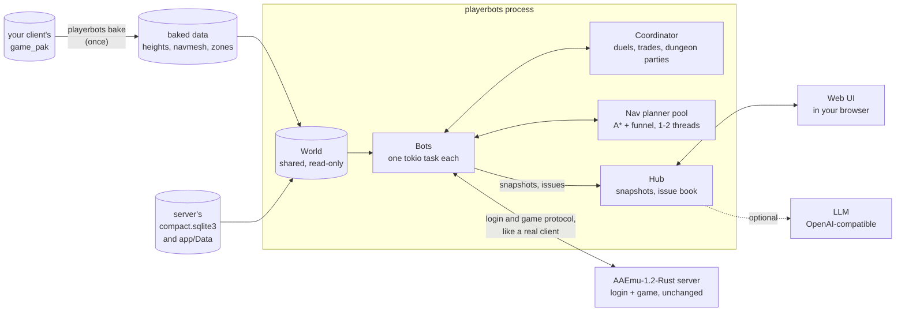

# aaemu-playerbots

[](https://github.com/NickMesser/aaemu-playerbots/actions/workflows/ci.yml)
[](LICENSE)
[](Cargo.toml)

**Headless ArcheAge 1.2 player bots for the [AAEmu Rust server](https://github.com/AAEmu/AAEmu-1.2-Rust).**
They quest, fight, duel, trade, run trade packs, own houses, find their way on the game's own
navigation mesh, travel by portal, run dungeons in parties and sail boats, and they report the server
bugs they hit along the way.


*40 bots on the Solzreed peninsula in the built-in web UI: live stats, activity filters and the bot
list beside a relief map rendered from the terrain heights.*

## Features

Each bot has an archetype (one of seven class builds with a skill rotation) and a temperament that
decides how much it likes quests, duels, trading, trade runs or staying home. A utility scorer weighs
the goals by the configured weights and the situation and draws the next one; the bot defends itself
whatever it is doing. Most features have a switch in `[behavior]`, `[social]`, `[llm]` or `[issues]`.

### Playing

| | |
| --- | --- |
| **Quests** | Journal first, then story, then the nearest side quest: walks to the giver, accepts, does the objectives (talk, kill, gather, use an item or doodad, reach a sphere) and turns in. Failures back off, repeated ones quarantine the quest. |
| **Grinding** | Kills level-appropriate monsters near the bot and loots them. |
| **Duels** | A coordinator pairs two idle bots; they meet at a flag, fight with their PvP rotation and rest afterwards. |
| **PvP** | Off by default (`[pvp]`). Bots fight back, retreat when hurt, ambush hostile trade-pack carriers (alone or in a squad, then collect and sell the dropped pack) and fight in zones at war; they never attack a friendly character, a character in its home zone or a name in `never_names`. |
| **Player trade** | Two bots meet, open the trade window, put up goods and money, lock and confirm. Trades with real players are off unless `trade_with_players` is set (and never while `gm_bootstrap` is on). |
| **Trade-chat market** | Bots with honestly gathered surplus advertise in trade chat, answer buyers (price, one counter, the place), meet them in town or on Mirage Isle and trade only a window that holds exactly what was agreed (`[market]`, see `docs/OPERATING.md`). |
| **Trade runs** | Crafts a trade pack at a specialty workbench, carries it to the NPC that buys it, sells it and collects the payment mail. Starts healthy, avoids deadly routes, keeps to the run while carrying, and goes back for a pack dropped on death. |
| **Auction house** | Walks to the nearest auctioneer now and then, lists whole stacks of honestly gathered goods at a price under the going rate, buys a bargain when the bot has gold of its own, and collects the sale, refund and won-lot mails. |
| **Housing** | Picks a design and a free spot in a housing area, quotes the tax, places the house, builds it and goes home to rest there. |
| **Gear** | On with `[gear] enabled`. Bots put on the best piece of their bag for their level (item level, grade, gems, the class build's armor and weapons; never above the level requirement), buy better pieces from merchants, mint the gear of their tier with GM commands, socket lunagems when the odds suit them, regrade if allowed, and choose the quest reward that suits them. The web UI shows what a bot wears. See `docs/OPERATING.md`. |
| **Farming** | Off unless `[farm] enabled`. Buys seeds from a vendor with the bot's own money, plants them in the garden of its house or on a public farm, remembers the plots, comes back when they are ripe, harvests and replants. It grows what is wished for (the director or the Economy view) or scarce before what merely pays, and the produce counts as the bot's own to sell only when the seeds were bought (never when they were minted with a GM command). Public farm polygons (`farm_areas.json`) come from `playerbots bake`; the web UI lists a bot's plots and the Economy view what is being grown. See `docs/OPERATING.md`. |
| **Guilds** | Off unless `[guild] enabled`. Five bots of one faction found a guild together (team, charter, a generated name), then the officers recruit unguilded bots of the faction, the owner appoints one or two officers, the members greet newcomers and chat now and then, and a member leaves now and then (an owner hands the guild over first). A real player gets an invitation by whispering "ginv" or "can i join" to an officer; bots never expel or demote a real player, and accept a player's invitation only with `accept_player_invites` (see `docs/OPERATING.md`). |
| **World events** | With `[events] enabled`, bots join a running rift (tower defence event): they walk to the defended target, hold within 40 m of it, kill the monsters of the current wave next to each other (a few at a time, `max_bots_per_event` and `max_share`) and leave when it ends or they are hurt. Bots keep out of zone groups at war (`avoid_war_zones`), and a rift whose waves never show, never advance or never end is filed as a server issue. |
| **Wild farms** | Off unless `[farm] wild`. Outlaw bots keep a few crops on a secluded patch out in the open (it costs labor), come back for them after a restart (the journal) and notice when somebody took them; with `steal` they take ripe crops of the other bots themselves. |
| **Exploring** | Bots go and see zones they have never been to, hills, the coast and recall points that are reachable and safe for their level, look around and remember where they have been; born explorers go more often (`[explore]`). |
| **Presence** | Off unless `[presence] enabled`. Bots log in and out on schedules of their own (early birds, evening players, night owls; casual and dedicated), never in the middle of a trade, a dungeon or a real player's party, within `min_online` and `max_online`; the Director view shows who plays when. |
| **Rest, wander, chat** | Recovers hit points and mana, strolls around, answers whispers and nearby players (canned lines or, optionally, an LLM in character). |
| **Personalities** | Every bot has its own way of talking (`[personality]`): chatterboxes and quiet ones, clowns who joke about labor, gankers, regrades, the queue and the Kraken, and potty mouths who swear now and then about the game under an operator cap (`profanity = "off" / "mild" / "strong"`). Bots say "ding", "rip" or "gg", remark on a sold pack or a finished house, chat near real players and now and then on shout, trade or group finding, all within per-bot and process-wide rate limits; slurs, hate, sexual words, insults and threats are refused for every line. |
| **Life-like movement** | In front of a real player a bot jumps now and then (on a straight run, at a step, to cheer a level), turns on the spot, pauses at corners, runs at its own pace, greets passers-by, answers an emote and sits down to rest. Each bot has its own temperament (some never jump); nothing happens without an audience or while the bot fights, trades or sails. Switch: `[behavior] lifelike`, `jump_rate`, `emotes`. |

Bots survive death (they ask for the resurrection), disconnects (reconnect with back-off) and name
rejections (a new name is picked); the roster remembers accounts and characters across restarts. The
details of every goal are in [docs/OPERATING.md](docs/OPERATING.md#goals-and-behaviour).

### Travel

**Navmesh pathfinding.** Bots walk routes on the navigation mesh that `playerbots bake` extracts from
the client's own files (one mesh for the main world, one per instance world) instead of straight
lines: a weighted A* with funnel smoothing, around walls, cliffs and water and along roads, with
rounded corners, a small per-bot sideways offset on long straights and a slower pace over the last
metres. Short trips are planned on the bot's own task, longer ones by a pool of one or two planner
threads; a goal the mesh cannot reach, or a planner that answers late, falls back to the straight line.


*The navigation mesh around Marianople: walkable triangles light slate, blocked space dark, roads
amber, indoor waypoints teal. The planned route (A* and funnel, 416 m) follows the road; the dashed
line is the straight line a bot without the mesh would take. Rendered by
`cargo run --release -p aa-bake --example nav_render -- <data dir>/nav_main_world.bin docs/images/navmesh-route.png --from 11380,11900 --to 11080,12030`.*


*A selected questing bot follows its navmesh route through the valleys; the panel shows its goal,
quests and event log and offers commands (pause, force a goal, duel, trade, say, whisper).*

**Portals.** Bots record Teleport Book entries with Memory Ink, open gates to them, use gates and
recall points when that is faster than walking, and hop through each other's gates.

**Sailing.** A bot summons a rowboat from a scroll at a beach, sails it 1 to 3 km across the sea (to
another beach or on a loop) with a heading controller that finds the wheel's direction by itself,
then leaves the boat, despawns it and swims ashore. Sea only. `[sail] ship` lets the bots sail the
bigger hulls instead (clipper, cutter, junk, yawl, merchant schooner, or a mix with `auto`): they
launch where the server has room for the hull, steer with its real speed and turn radius, take
rounded routes and berth out at sea.


*Seven bots sailing rowboats across the Arcadian Sea; the selected one shows its sailing log
(speed, throttle, steering, heading error, distance to go).*

### Group content

**Dungeon parties.** Bots that like a fight ask the coordinator for a party of up to five (the
dungeon's player limit, never more than five; same alliance, a level the dungeon accepts), and wait
`[dungeons] relax_after_secs` for it to fill before going with a smaller one. The leader invites,
the party walks to the entrance, goes in one by one and clears the dungeon along a route of its
hostile spawns: the leader picks targets, the members follow and assist, everybody rests when low.
Then they use the exit and disband. The server's refusals are answered by kind; the entry limit is
counted only with `[dungeons] entry_limit` (off by default: the 1.2 server has none).

**Parties of real players.** With `[party]` on, a bot joins the party a real player invites it to (or
invites the player who whispers `inv`), follows the leader across the map, helps in the fights, obeys
`follow`, `stay`, `come`, `assist`, `leave` and `dungeon <name>`, and goes through a dungeon door
behind the leader and out again with it. It says no at once when it is busy, in a team already or
the levels are too far apart. See [OPERATING.md](docs/OPERATING.md#parties-of-real-players-party).

### Server QA

Bots are the first players of a new server, so they also find its bugs. They notice problems with the
**server**, not with themselves: a quest that gives no credit, an NPC or doodad that is not where the
data says, a kick, a stall, a character that dies without a death packet, a trade that does not pay
what it should, a warning in the server log that names the bot. Reports are deduplicated by what went
wrong (fifty bots meeting one bug make one issue with a count), and each comes with the packet trail,
the bot's position and goal and the server log lines around it, written to an evidence folder. You can
append a short entry per issue to a text file that a team or its agents work from.


*The Issues panel: the list of detected problems and the detail of a queued "server stalled" issue
with what was expected, what happened, how often, the evidence folder and the samples.*

How the detectors judge, what is reportable, the queue file and the privacy rules are in
[docs/ISSUES.md](docs/ISSUES.md).

### Operator tools

* **Web UI** (`http://127.0.0.1:8790/` by default): a live map of every bot by activity with houses,
  duel flags and trade outlets, a searchable bot list, per-bot state, quests, chat and event log, the
  Issues panel and the process stats. Commands: pause or resume, force a goal, make two bots duel or
  trade, say a line, whisper, spawn and despawn bots.
* **World metrics and a population director**: World, Economy and Director views in the web UI show
  where the players and the bots are by continent and side (and on the map as heat), which items are
  scarce, and what the director does. The director can log bots in and out to follow the players
  (the west gets bots when the east fills up) within caps, and it is off, then a dry run, by default.
  Spawn and despawn by side, race and continent. Optional use of the game server's web API for exact
  counts. See [docs/OPERATING.md](docs/OPERATING.md#world-metrics-and-the-population-director).
* **Optional LLM** (DeepSeek, or any OpenAI-compatible `chat/completions` endpoint): bots answer
  players with a short in-character line and, with the director on, plan their next few steps
  (explore a zone they have never seen, wander to a town, farm wild land, ...) now and then and
  after a level-up, a death or a failure, keeping short notes in their journal. It is off by
  default, never on the tick path, rate limited and budgeted per UTC day, picks only among what the
  bot may do, and its output is filtered (no commands, links or "I am an AI"). Everything works
  without it. See [docs/OPERATING.md](docs/OPERATING.md#chat-and-the-llm).
* **Agent API and MCP**: an LLM outside the process can drive the bots too: `GET /api/agent/tools`
  describes every action with a JSON schema, `GET /api/agent/observe/{id}` shows one bot in a few
  dozen lines, and `playerbots mcp` offers the same tools to Claude Code, Claude Desktop or any
  other MCP client. See [docs/OPERATING.md](docs/OPERATING.md#agent-api-and-mcp).

## How it works



Every bot is an ordinary game client written in Rust: it logs in through the login server, creates or
selects a character and plays over the normal client protocol, so to the AAEmu server a bot is just
another player and the server needs no changes. One tokio task per bot owns its connection and state;
the static world knowledge (templates from `compact.sqlite3`, spawn files, terrain heights, navigation
meshes) is loaded once into a read-only `World` that all bots share. A coordinator pairs bots for
duels, trades and dungeon parties, a small thread pool plans long routes, and the hub collects the
bots' snapshots for the web UI and the issue book. Terrain and navigation meshes are baked once from
your client's `game_pak` and memory-mapped at run time. The design is described in
[docs/DESIGN.md](docs/DESIGN.md), the baked file formats in [docs/DATA-FORMATS.md](docs/DATA-FORMATS.md).

## Quick start

You need:

* Rust 1.88 or newer.
* A running [AAEmu-1.2-Rust](https://github.com/AAEmu/AAEmu-1.2-Rust) server whose login server
  creates unknown accounts (`AutoAccount`).
* Your own, legally obtained ArcheAge 1.2 client (r208022): the bake reads its `game_pak`.
* The server's `compact.sqlite3` and its `app/Data` folder (in an AAEmu-1.2-Rust checkout they live
  in `rust/crates/aaemu-game/app/Data`).

```sh
# 1. build (the binary is target/release/playerbots, with .exe on Windows)
cargo build --release -p playerbots

# 2. bake the data from your client, once: about 15 seconds and 0.4 GB
#    (navigation mesh 228 MB, terrain heights 174 MB, plus the map, zones and housing areas)
playerbots bake --pak <client>/game_pak --out <data dir> \
    --compact <AAEmu>/rust/crates/aaemu-game/app/Data/compact.sqlite3

# 3. write the commented example configuration, then edit it
playerbots example-config > playerbots.toml

# 4. start the bots; Ctrl+C logs them out
playerbots run --config playerbots.toml
```

In `playerbots.toml` set `[server] login` (the login server's public address), and in `[data]` the
paths `compact`, `server_data` (the server's `app/Data`) and `baked` (the `--out` directory of the
bake). The bake is optional, but without its data the bots walk straight lines on flat ground and the
map has no picture. Once the bots run, open `http://127.0.0.1:8790/`. The map shows the painted world
map of your client when the bake finds it and a relief rendered from the terrain heights otherwise
(the screenshots here use the relief).

* `playerbots run --count 50 --duration-secs 600` overrides the bot count and stops after ten minutes.
* Bot accounts are `pb1`, `pb2`, ... with one shared password: `server.password`, else
  `$PLAYERBOTS_PASSWORD`, else a random one that the first run generates into `roster.secrets.json`
  next to the roster. Keep that file together with `roster.json`.
* The web UI is read-write (it can despawn bots and send chat). It listens on loopback only by
  default; before you expose it, set `[web] token` (POST requests then need the `x-playerbots-token`
  header).

**GM bootstrap.** Housing, trade runs, portal ink and stones, boat scrolls and the dungeon level-up
need materials, labor, gold or levels a fresh character does not have. With `bots.gm_bootstrap = true`
the bots give those to themselves with GM chat commands, which needs access level 100 on the bot
accounts. Print the SQL, run it on the game database and restart the bots:

```sh
playerbots grant-gm-sql --config playerbots.toml
```

The bot accounts are GM accounts afterwards, so give them a private password (the generated one is)
and keep the roster and `roster.secrets.json` private; the safety rules and the full list of GM
commands the bots may send are in [docs/OPERATING.md](docs/OPERATING.md#gm-bootstrap).

## Memory and scale

Measured against a local AAEmu Rust server:

| Run | Per bot | Whole process |
| --- | --- | --- |
| 100 bots, mixed goals, 25 minutes, debug build, before the travel features | about 82 KiB private memory, 0.22 % of one CPU core | about 54 MB, world data included |
| 40 bots, every feature on (navmesh, portals, dungeons, sailing) | about 0.11 MB private memory, about 0.13 % of one core | about 224 MB resident set (see below) |

* Route planning on the navigation mesh takes about 1 ms (median) and about 30 ms (99th percentile)
  for routes of up to 2 km, on a pool of one or two threads.
* The game server spends about 0.5 MB and 0.5 to 0.6 % of a core per bot, about what a real player costs.
* In the 100-bot run, in crowded start areas, a bot sent about 1.2 packets/s and received 90 to 100
  per second, with no disconnects.

**Why the web UI's Memory tile reads several MB per bot** (4.8 MB/bot in the screenshots). The tile
shows the resident set of the whole process, and "per bot" is its growth since start divided by the
bots online. The resident set includes the memory-mapped navmesh and terrain pages the bots touch:
file-backed pages that all bots share and the operating system can drop again, not memory a bot owns.
The per-bot allocations are the ~0.1 MB above (the fixed part of a bot is about 3 KB, and everything
else is bounded: [docs/OPERATING.md](docs/OPERATING.md#memory-and-scale)).

## Known limitations

* Where the navigation mesh has no route the bot falls back to the straight line (about one in five
  random goals near the Nuian start).
* Dungeon navigation meshes are split into rooms, and no party has killed a dungeon boss yet (the
  parties are level 18 in starter gear).
* Quest progression walks: a bot never rides a carriage or an airship, so a trip to a zone it
  can only reach that way fails and the destination rests for a while. A trip ends as soon as
  any quest comes within 1500 m, so a bot on its way can be drawn aside by a side quest.
* Sailing is sea only (no lakes or rivers) and has no passengers yet; the bigger hulls sail with
  their driver only (no crew, no cannons, no cargo).
* Portal ink and stones, boat scrolls and the dungeon level-up need the GM bootstrap unless the bot
  already carries them.
* Built for, and tested against, AAEmu-1.2-Rust and the 1.2 client (r208022) only.

## Repository layout

| Crate | Role |
| --- | --- |
| `crates/proto` (`aa-proto`) | Wire protocol: framing, login client, game connection, packet builders and parsers. |
| `crates/world` (`aa-world`) | Static world knowledge from `compact.sqlite3`, the server's spawn files and the baked data: spatial index, terrain, navigation meshes, sea map, travel data. |
| `crates/bake` (`aa-bake`) | One-off extraction of terrain, navigation meshes, map, zones, housing areas, public farm polygons and quest spheres from `game_pak`; the `nav_render` example draws a mesh and a route. |
| `crates/web` (`pb-web`) | Operator web UI (JSON API and a single-page map). |
| `crates/llm` (`pb-llm`) | The optional OpenAI-compatible client with rate limit, concurrency cap and token budget. |
| `crates/playerbots` | The binary: config, roster, bot runtime, goals, coordinator, hub, supervisor, server issue reports. |

Documentation: [OPERATING.md](docs/OPERATING.md) (configuration, goals, GM bootstrap, chat and LLM,
web UI), [ISSUES.md](docs/ISSUES.md) (server issue reports), [DESIGN.md](docs/DESIGN.md)
(architecture) and [DATA-FORMATS.md](docs/DATA-FORMATS.md) (baked files).

## Development

See [CONTRIBUTING.md](CONTRIBUTING.md). In short: `cargo fmt --all --check`,
`cargo clippy --workspace --all-targets -- -D warnings` and `cargo test --workspace` (the same checks
run in CI on Linux and Windows). Tests that need real game data are `#[ignore]`d; run them with
`AA_COMPACT`, `AA_SERVER_DATA`, `AA_BAKED` and `AA_PAK` set, for example
`cargo test -p playerbots -- --ignored`. No test contacts an external host: the LLM tests use a mock
endpoint on 127.0.0.1.

## Credits

* The behaviour of the bots, their class builds and the skill rotation files in
  `crates/playerbots/data/rotations/` come from
  [NulightJens/ArcheAge-PlayerBots](https://github.com/NulightJens/ArcheAge-PlayerBots), a
  server-side mod for AAEmu. The rotation JSON files are copied unchanged (see
  `crates/playerbots/data/rotations/NOTICE`) and run by this project's own rotation engine in
  `crates/playerbots/src/bot/rotation/`. Upstream is distributed under GPL-3.0-or-later (its
  `LICENSE.md`) and notes that retained MIT-covered contributions keep their own terms.
* The wire protocol, packet layouts and several data-format readers follow the code of
  [AAEmu](https://github.com/AAEmu) (GPL-3.0), in particular
  [AAEmu-1.2-Rust](https://github.com/AAEmu/AAEmu-1.2-Rust), the server these bots are built to play on.

## Disclaimer

This is an unofficial fan project. It is not affiliated with or endorsed by XLGAMES, Kakao Games,
Trion Worlds or Gamigo. It contains no game assets: you need your own legally obtained ArcheAge 1.2
client and the AAEmu server data. ArcheAge is a trademark of its respective owners. The bots log in
and play like real clients, so run them against servers you operate or have permission to test.

## License

GPL-3.0-or-later, see [LICENSE](LICENSE).
